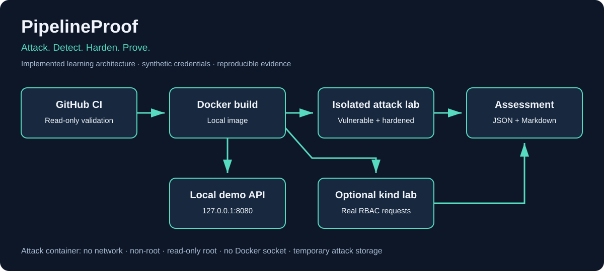

# PipelineProof — CI/CD Security Attack & Defense Lab

[](https://github.com/Aventador-LP700/DevOps-Learning/actions/workflows/ci.yml)
[](LICENSE)

**Attack a pipeline. Collect evidence. Apply a control. Prove the same attack fails.**

PipelineProof is an open-source, local-first CI/CD and application penetration-testing
lab with 25 implemented scenarios. Twenty-four local exercises cover pipeline and
application trust boundaries; scenario 05 uses a real local Kubernetes API to
demonstrate excessive CI deployment permissions and scoped RBAC.

Built for learners and reviewers who want reproducible evidence of CI/CD VAPT,
not just screenshots of installed security tools.



## Expanded application-security labs

**25 implemented scenarios:** the original 01–05 plus 20 new vulnerable/fixed labs
covering OWASP Top 10:2025. Native/Docker assessment runs execute 24 local scenarios;
05 remains a separate real Kubernetes integration. Existing 01–05 walkthroughs and
pipeline implementations are preserved.

Each new lab includes executable vulnerable and fixed modules, a harmless proof,
vulnerability/remediation/positive tests, detection guidance and knowledge checks.
Two additional browser tests verify actual stored-XSS execution and credentialed
CORS reads. The secure-default HTTP adapter exposes selected application labs:

```bash
python3 -m labs.web --port 8081
# Vulnerable services require explicit opt-in:
python3 -m labs.web --port 8083 --vulnerable --enable-vulnerable-labs
```

All new services bind to loopback. No HTTP endpoint exposes shell execution,
pickle restoration, arbitrary SSRF targets or package installation.

- [All 25 walkthroughs](scenarios/README.md)
- [Vulnerability/CWE/OWASP matrix](docs/VULNERABILITY_MATRIX.md)
- [Startup, tests and cleanup](docs/OPERATING_LABS.md)
- [Expanded architecture](docs/ARCHITECTURE.md) and [threat model](docs/THREAT_MODEL.md)
- [Security gates and intentional findings](docs/SECURITY_GATES.md)
- [Current scenario audit and exact results](docs/SCENARIO_AUDIT.md)
- [Recorded expansion validation](docs/EXPANSION_VALIDATION.md)
- [Knowledge checks](docs/KNOWLEDGE_CHECKS.md) and [technical demonstration](docs/DEMO_GUIDE.md)

## Start without Docker

With Bash and Python 3.10+ installed (Linux, macOS or WSL2):

```bash
git clone https://github.com/Aventador-LP700/DevOps-Learning.git
cd DevOps-Learning
bash ./setup.sh
```

This runs the 24 local exercises, writes reports directly into `reports/`, then
serves the demo API at **http://127.0.0.1:8080**. Stop it with **Ctrl+C**.
No Docker, Make, pip dependencies, sudo or automatic package downloads are required.

```bash
bash ./setup.sh --lab-only          # run exercises and exit
bash ./setup.sh --serve-only        # start just the API
bash ./setup.sh --port 8090          # use a different localhost port
bash ./setup.sh --help
```

Native mode executes fixed teaching payloads as your user in temporary directories;
it has **no container isolation or network restriction**. Use a disposable VM when
modifying attack code. Reports record `execution_mode: native`. The Kubernetes,
container-image scanning and image-based SBOM extensions still need their own tools
and a container runtime. See [deployment options](docs/deployment.md).

## Five-minute start with Docker

Requirements: Docker Engine or Docker Desktop with Compose v2, Git, Python 3.10+,
and Make. Start Docker before running these commands. Linux and WSL2 are the
primary targets; see [platform notes](docs/deployment.md).

```bash
git clone https://github.com/Aventador-LP700/DevOps-Learning.git
cd DevOps-Learning
make lab
make report
make up
curl http://127.0.0.1:8080/health
```

Open `reports/assessment.md` to review attack evidence and hardened retests.
The demo API binds to `127.0.0.1:8080`. `make down` stops it. `make clean`
also deletes the lab evidence volume; exported host reports remain.

Expected exercise output:

```text
PASS pipeline-injection
PASS secret-exposure
PASS artifact-tampering
PASS security-gate-bypass
# ...20 new scenarios follow...
PASS fail-open-error-handling
```

A PASS means the exploit succeeded against the vulnerable step **and** the
hardened control blocked the same attack. Unexpected outcomes fail the command.
See [recorded validation](docs/validation.md) for what has actually been tested.

## Exercises

| Exercise | Attack evidence | Hardened retest | Walkthrough |
|---|---|---|---|
| Pipeline injection | Change-title payload creates a temporary marker | Metadata passed as an argument; no marker created | [01](scenarios/01-pipeline-injection/README.md) |
| Secret exposure | Synthetic credential appears in captured build logs | Same credential is absent from logs | [02](scenarios/02-secret-exposure/README.md) |
| Artifact tampering | Modified JSON is consumed without verification | Trusted SHA256 digest rejects modified bytes | [03](scenarios/03-artifact-tampering/README.md) |
| Gate bypass | Advisory step exits successfully despite a critical finding | Enforced severity policy rejects the report | [04](scenarios/04-security-gate-bypass/README.md) |
| Excessive deployment permissions | Lab CI identity reads a synthetic Kubernetes Secret | Read is forbidden; intended deployment patch still works | [05](scenarios/05-excessive-permissions/README.md) |

The core gate exercise uses an explicitly labeled **synthetic Trivy-format
fixture**. `make scan` runs a real installed Trivy scanner against the lab image.
The manual **Live security tools** workflow runs real image scanning, source/secret
checks and signed SBOM retests. A scanner finding can legitimately block its release job.
The artifact exercise verifies a trusted digest; it does not claim to demonstrate
signatures. [Supply-chain extensions](docs/tooling.md) include Syft and Cosign.

## Kubernetes exercise

Install kind and kubectl, then:

```bash
make k8s-up
make k8s-test
cat reports/rbac.json
make k8s-down
```

All script requests explicitly target `kind-pipelineproof`. The test temporarily
applies excessive permissions **only within the lab namespace**, makes a real
API request using service-account impersonation, and restores scoped RBAC on exit.
Use a disposable local machine or VM. See [deployment instructions](docs/deployment.md).

## Repository map

```text
app/                    Small deployment target and health endpoint
lab/                    Exercise runner, controls, JSON/Markdown reports
pipelines/vulnerable/   Deliberately insecure teaching steps
pipelines/hardened/     Corrected steps and enforced release policy
infra/                  kind cluster, app deployment, vulnerable/hardened RBAC
scenarios/              Threats, reproduction, detection, remediation, retest
fixtures/               Synthetic scanner report; no real credential or CVE
policies/               Release policy
scripts/                Report export, real image scan, signing, Kubernetes tests
tests/                  Control edge cases and HTTP tests
.github/workflows/      Read-only validation CI and manual Kubernetes integration
```

## Engineering decisions

- Docker mode: the attack container runs as a non-root user with no network, dropped
  capabilities, a read-only root filesystem, and bounded resources.
- No Docker socket, host checkout, or cloud credentials enter the attack container.
- Attacks write temporary files; only generated assessment evidence persists.
- Repository CI uses read-only GitHub permissions, immutable action references,
  and no persisted checkout credentials. It never evaluates PR metadata as shell code.
- The initial version uses local Python pipeline steps and GitHub validation CI.
  It does not deploy a Gitea server/runner or claim to emulate GitHub's token model.
  This keeps the exercises runnable without privileged runner infrastructure.
- Evidence distinguishes reproducible teaching fixtures from real infrastructure tests.

Read the [threat model](docs/threat-model.md), [architecture](docs/architecture.md),
[assessment template](docs/assessment-template.md), and [technical demonstration guide](docs/DEMO_GUIDE.md).

## Safety and scope

Intentionally vulnerable steps are teaching material. Use `make lab` for container isolation, or `bash ./setup.sh` for the fixed native
exercises. Native mode has no sandbox; use a disposable VM for modified attacks. Use synthetic data and your own disposable lab.
The project is not a production deployment template or a certification of security.
See [SECURITY.md](SECURITY.md) and [CONTRIBUTING.md](CONTRIBUTING.md).

This repository also preserves the original DevOps study file. MIT license applies
to the PipelineProof implementation added here.
