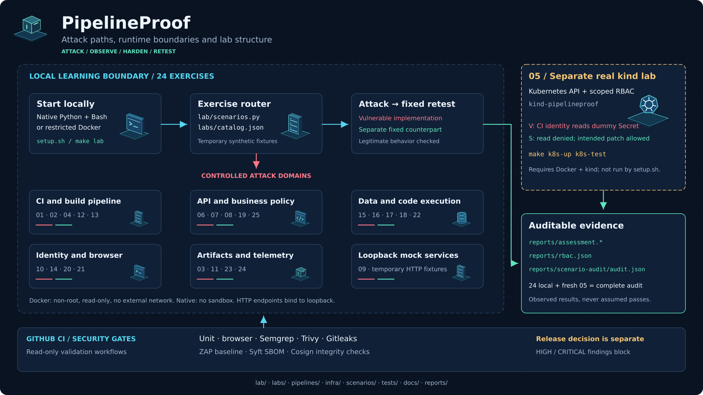
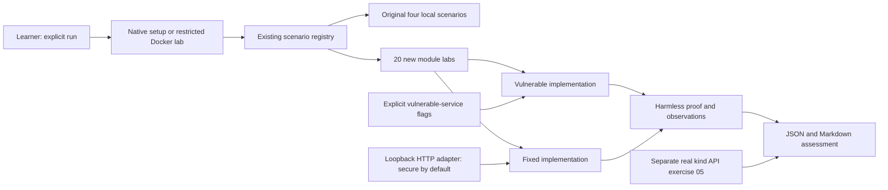
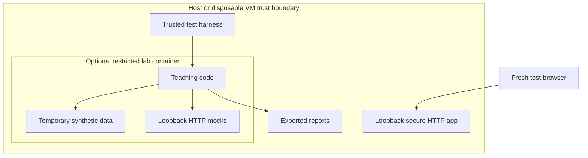
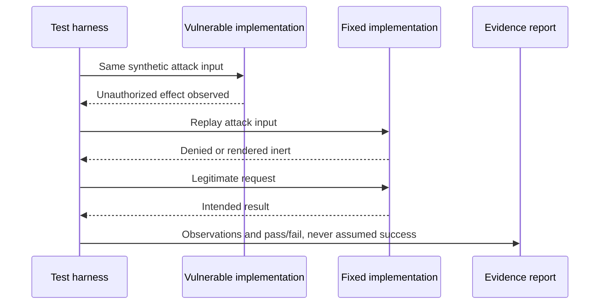

# Expanded architecture

The existing repository is PipelineProof in `DevOps-Learning`. This extension
implements the requested SecureForge-style learning scope without renaming or
replacing the original project. It retains standard-library Python, the existing
CLI/report shape, native Bash setup, Docker controls and kind deployment.

## Architecture images

The [complete attack map](diagrams/pipelineproof-attack-map.svg) shows all 25 scenarios,
their code locations and fixed controls. [Download its vector PDF](diagrams/pipelineproof-attack-map.pdf)
for zooming or printing. See the [diagram guide](diagrams/README.md) for formats,
legend, scope and regeneration commands.

## Execution and evidence

New packages live under `labs/<slug_with_underscores>/`. Each contains separate
`vulnerable.py`, `secure.py`, `attack.py` and `test_lab.py`. A metadata catalog supplies
classification and discovery; the existing registry is extended additively. The
runner considers a lab passed only when the observed exploit, blocked attack and
legitimate-operation checks all succeed.

All real network fixtures use 127.0.0.1 with allocated ports. The SSRF safety envelope
allows only the two mock origins, even in vulnerable mode. The local registry is a
JSON service, not an internet-facing package registry. No runner mounts host sockets
or credentials. The original Docker image includes teaching modules intentionally;
it is not advertised as a clean production artifact.

Native mode uses the same modules but is not a sandbox. Vulnerable libraries are not
imported as defaults by the secure HTTP adapter. Only explicit runtime selection
chooses vulnerable implementations. High-risk command/deserialization/build-hook
proofs remain CLI-only and operate on fixed temporary fixtures.

## Attack-to-remediation flow

See the [earlier architecture](architecture.md) for original design decisions,
[operating guide](OPERATING_LABS.md) for commands and
[security gates](SECURITY_GATES.md) for scan boundaries.
