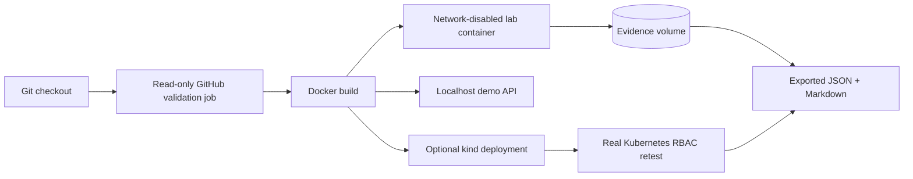

# Architecture and trust boundaries

## Implemented execution model

The local runner invokes small vulnerable/hardened pipeline steps with identical
untrusted inputs. These subprocesses execute inside a disposable, non-root container.
A temporary directory holds each attack's effects. The persistent volume holds only
assessment output. The host exports reports using `docker cp` from a temporary reader.

The demo HTTP service is deliberately small: it is a deployment target, not an
application vulnerability playground. The security subject is the pipeline trust chain.

The Kubernetes test is separate because it needs an administrator-controlled local
cluster. Scripts hard-code the named context to avoid accidentally applying RBAC to
whatever context happens to be current. Excessive privileges are namespace-scoped;
no cluster-admin binding is created for the CI identity.

## Artifact trust

The core tampering exercise models a build producing an artifact and trusted digest,
then a storage attacker modifying the artifact. Verification uses the digest retained
outside attacker-controlled storage. It cannot protect against a compromised builder
or an attacker who can replace both artifact and expected digest. The optional Cosign
extension demonstrates detached signatures using ephemeral lab keys.

## Deliberate scope choices

A local registry and Gitea/Actions runner were part of the initial concept graphic.
They are not required or shipped in this implementation: local Docker image storage,
small observable steps, and GitHub validation provide a simpler reproducible baseline.
A future forge/registry exercise needs its own threat model, safe runner isolation,
and end-to-end integration checks before being advertised as supported.
