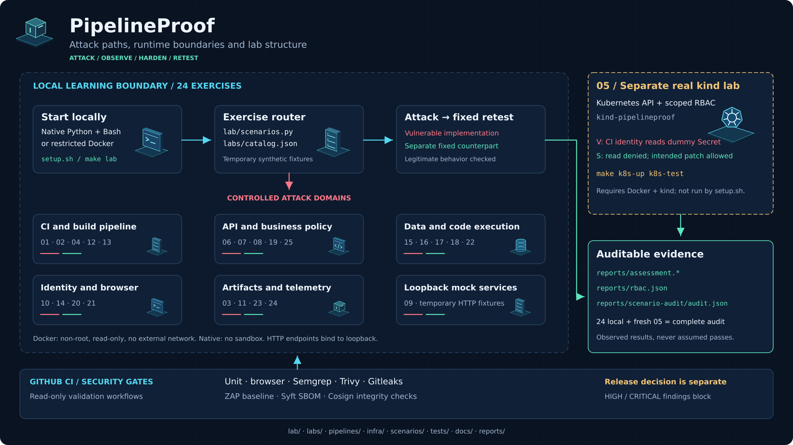
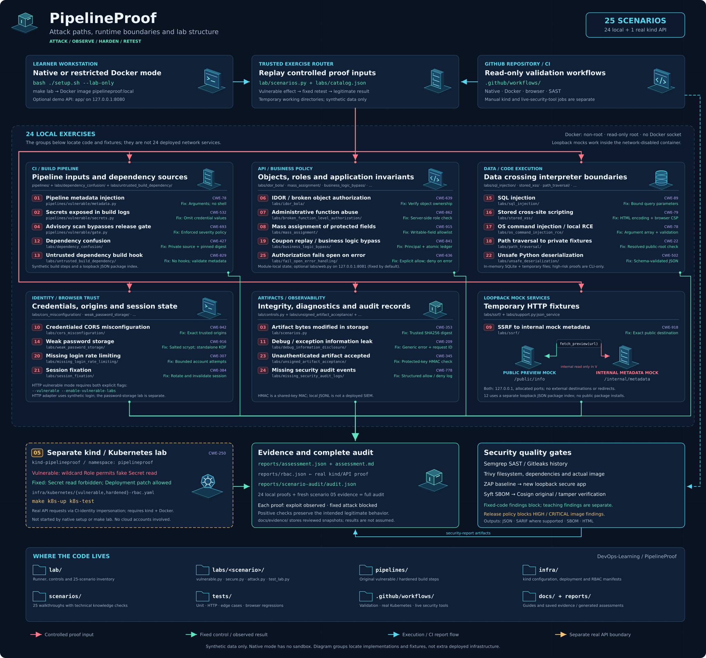

# Lab architecture and attack maps

Two diagrams describe the implemented PipelineProof repository. The full map places
all 25 numbered scenarios beside their source paths and fixed controls; the overview
is designed for the repository README.

| Diagram | Sharp at any zoom | Print / share | Fixed-resolution preview |
|---|---|---|---|
| Full 25-scenario attack map | [SVG](pipelineproof-attack-map.svg) | [Vector PDF](pipelineproof-attack-map.pdf) | [6000 × 5600 PNG](pipelineproof-attack-map.png) |
| Architecture overview | [SVG](pipelineproof-overview.svg) | [Vector PDF](pipelineproof-overview.pdf) | [3600 × 2025 PNG](pipelineproof-overview.png) |

Use **SVG or PDF** when zooming. Both contain vector paths; the PDF text is exported
as vector outlines so it does not depend on locally installed fonts. The PNG is a
convenience preview with a fixed pixel resolution. JPEG would introduce compression
artifacts and does not provide the same zoom quality, so the vector files are the
masters.

[](pipelineproof-attack-map.svg)

## Full attack and placement map

[](pipelineproof-attack-map.svg)

## Read the map

- **Red:** controlled proof inputs and the vulnerable path.
- **Teal:** fixed controls, observed retest results and evidence flow.
- **Cyan:** execution, CI validation and security-report flow.
- **Amber dashed boundary:** the separate real kind/Kubernetes API exercise, 05.
- **Blue dashed boundary:** the 24 local exercises, using native Python or the
  restricted Docker lab. Native execution has no operating-system sandbox.

Isometric icons locate components and fixture types. They do not imply extra
microservices, a public cloud deployment, a production package registry or a SIEM.
The SSRF diagram shows the preview function requesting either a public mock or an
internal mock; it does not depict a redirect or a compromise of the public mock.

## Where things are placed

| Component | Runtime / address | Source |
|---|---|---|
| Native entry point | Learner's workstation | `setup.sh` |
| Restricted lab runner | `pipelineproof:local`, no external network | `compose.yaml`, `Dockerfile`, `lab/` |
| Original deployment API | Host loopback `127.0.0.1:8080` | `app/` |
| Optional HTTP application labs | Host loopback `127.0.0.1:8081` by default | `labs/web.py` |
| SSRF and package-index mocks | Temporary, allocated `127.0.0.1` ports | `labs/support.py`, scenarios 09 and 12 |
| SQLite, marker files, JSON artifacts and audit JSONL | In-process / temporary lab storage | Individual `labs/<scenario>/` packages |
| Real deployment-permission exercise | `kind-pipelineproof`, namespace `pipelineproof` | `infra/`, `scripts/k8s.sh` |
| Automated validation and optional security tools | GitHub Actions workflows | `.github/workflows/` |
| Generated evidence | `reports/` or Docker evidence volume before export | CLI runner, `scripts/export_reports.py` |
| Saved audit records and technical guides | Repository files | `docs/evidence/`, `docs/` |

The HTTP adapter defaults to fixed implementations. Vulnerable HTTP mode requires
both explicit flags. Password-storage lab 14 is a standalone KDF exercise, not the
HTTP adapter's credential database. The artifact authenticator in 23 is HMAC; the
separate Cosign extension provides a real signed-SBOM exercise. Image security gates
can block a release even when teaching proofs pass.

## Regenerate

From the repository root, with Python 3.10+:

```bash
python3 -m scripts.render_architecture
```

This generates the two editable SVG files using only Python's standard library and
the existing scenario inventory. To also regenerate PDF and PNG, install Inkscape
with your operating system's normal package manager, then run:

```bash
python3 -m scripts.render_architecture --export
```

The script does not start services, execute attacks, install packages or change
system settings. Its optional exporter stores its own configuration/cache under
`.work/diagram-render/`. Existing scenarios and runtime behavior are unchanged.

## Export checks

The delivered map contains each scenario ID 01–25 exactly once. Both SVG files
contain no embedded raster images, scripts or rasterizing SVG filters. Both PDFs
are single-page vector documents with zero embedded raster image objects. The PNG
dimensions were checked against the table above, and local documentation links
were verified. No scenario implementation or test outcome was changed for these
illustrations.
